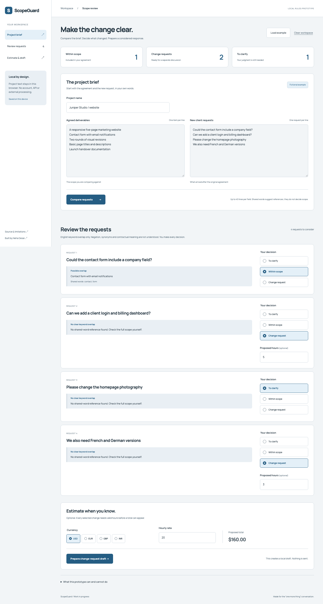

# ScopeGuard

**Keep the work clear before “one more thing” becomes an unplanned project.**

[Try the local playground](https://neha-pd.github.io/scopeguard/) · [Neha Desai](https://github.com/neha-pd)

An in-progress personal prototype for freelancers: compare an agreed scope with new client requests, review the suggested references, and export a change-request draft. Built with AI assistance. **The current analyzer is transparent local keyword matching, not an AI model.** No production outcomes, customer adoption or accuracy claims.



## The workflow

1. Enter the agreed deliverables and new requests, one per line.
2. Compare. The app finds the scope line with the largest fraction of shared meaningful English words.
3. Review every request yourself. Choose **Within scope**, **Change request**, or **To clarify**. All requests initially require clarification; the heuristic never makes the commercial decision.
4. Optionally enter hours for every selected change, an hourly rate and currency. Incomplete or nonpositive values never produce a quote. No market rate or effort estimate is invented.
5. Prepare, copy or download a plain-text draft. It includes the original scope, requested changes, selected decisions, shared-word references and the estimate only when complete.

The startup example is explicitly fictional. Nothing is emailed, charged or sent to a client. This does not interpret contracts or provide legal advice. A draft is for discussion, not a signed change order.

## Run locally

```sh
python3 -m http.server 8838
# Open http://localhost:8838
```

Static browser-native Vue 3 ESM with pinned vendored runtime. No build step, keys, backend, analytics or third-party runtime requests. Project text stays in this browser's localStorage. The clipboard receives the draft only when Copy is clicked; Download creates a local text file. Clear the workspace on shared devices.

## Project structure

- `src/core.js`: pure analysis, pricing validation and draft generation functions.
- `src/app.js`: Vue state, local persistence and UI. User-entered content is rendered as text, never injected HTML.
- `styles.css`: responsive cool paper workbench with light/dark tokens.
- `tests/browser.py`: actual Chromium checks and screenshot capture.
- `vendor/`: Vue version/source and upstream license.

```js
import { analyze, pricing, makeDraft } from './src/core.js';
const requests = analyze('Contact form with email notifications',
                         'Add a company field to the contact form');
// [{ status: 'review', reference: 'Contact form ...', matches: [...] }]
// Commercial decisions are always made by the person reviewing the result.
```

## Validation

```sh
python3 -m pip install playwright
python3 -m playwright install chromium
python3 tests/browser.py http://localhost:8838
```

Browser checks cover matching and review defaults, manual override, invalid/incomplete/valid pricing, exact clipboard/download output, persistence, stale-source protection, reset confirmation, HTML-as-text rendering, mobile overflow and runtime errors. Actual screenshots and check results are in `artifacts/`.

## Known limits

- English word overlap is deliberately shallow. Synonyms, negation, quantities, exclusions and contractual meaning are not understood. “No dashboard” and “add dashboard” can overlap. Do not treat a matched line as permission or proof.
- Up to40 nonempty lines per input,10,000characters per field. Formatting and attachments are not interpreted.
- Currency selection formats numbers; it performs no conversion. User effort estimates are not validated against project complexity. Taxes, payment terms and scheduling must be agreed separately.
- Updating the source brief requires a new comparison, which resets decisions. Historical versions are not retained.
- No authentication, sync, encrypted storage or collaborative editing. Anyone with access to the same browser profile can read local data.
- Modern browser required. Clipboard availability depends on browser permission and secure context; text selection/download remain available.
- Chromium interaction testing is not a complete accessibility or security audit. Safari/Firefox and screen-reader testing remain open.

## AI roadmap, clearly separated from current behavior

A future consent-based model adapter would accept structured scope/request records and return candidate references, conflict flags and cited evidence. It should:

1. Ask before transmitting any client text to a model provider, explain retention, and support redaction.
2. Keep original text and model suggestions separate; never overwrite a user decision.
3. Validate a strict response schema and require references back to original scope items.
4. Abstain on ambiguous terms, quantify limitations, and compare against a human-reviewed evaluation set containing exclusions, synonyms and contradictory changes.
5. Keep hours, rates, financial commitments and sending behind explicit user input/action.

No adapter, provider credentials or semantic model exists in this release. Additional planned work: versioned scope snapshots, per-project storage, import/export of structured projects and broader browser/accessibility validation.

MIT licensed. Vue/Manrope retain upstream licenses. Design direction informed by [taste-skill](https://github.com/leonxlnx/taste-skill).

## Interface redesign

The workspace now uses side-by-side source editors, explicit radio decisions and a persistent workflow rail. [Design references and decisions](DESIGN.md) document the original direction. All local analysis and commercial safeguards remain unchanged. Light/dark automated axe results are in `artifacts/axe.json`.
